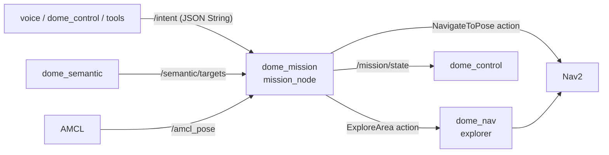
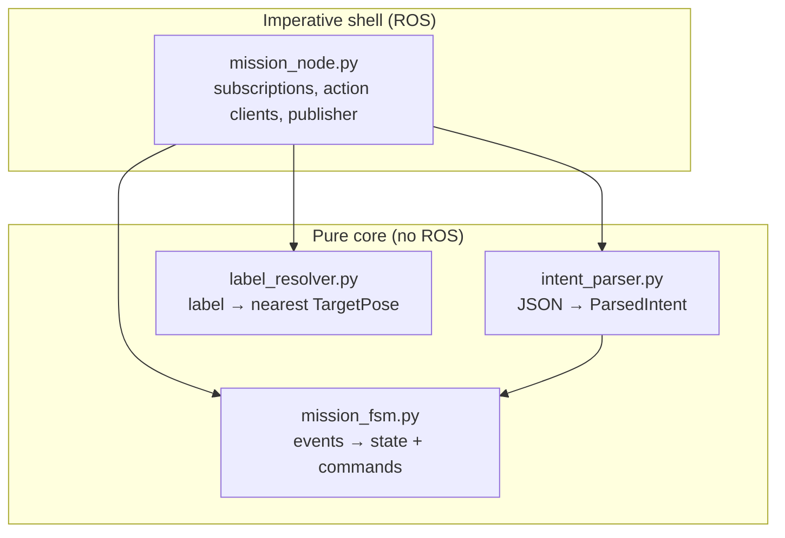
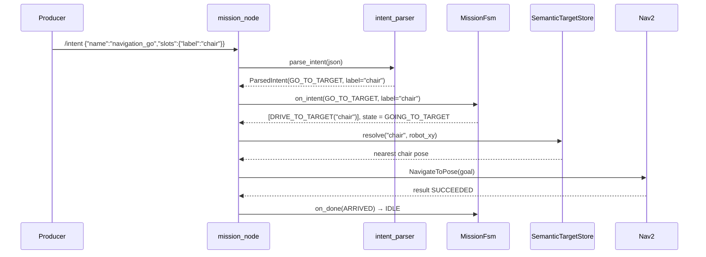

# dome_mission — Theory of Operation

## What this package is for

The DOME robot can do several high-level things: **explore** an unknown space,
**locate** objects while it explores, and **drive to** a named object ("go to the
chair"). Someone has to decide which of those is happening at any moment, start
it, stop it, and notice when it ends.

That someone is **dome_mission**, the *mission-sequencing layer*. It sits between
the things that issue requests (voice, `dome_control`'s CLI, diagnostic tools)
and the things that move the robot (dome_nav's explorer, Nav2).

## Why it exists as its own package

dome_mission was **extracted from dome_nav** (feature F03). dome_nav had grown
mission logic and semantic knowledge — label lookups, `/intent` handling — that
didn't belong in a navigation package.

The extraction enforces a clean layering:

- **dome_nav is primitives only.** It exposes an `ExploreArea` action and knows
  nothing about labels, missions, or `dome_semantic_msgs`.
- **dome_mission owns intent and meaning.** It is the *sole* `/intent` handler
  in the system and the only place labels are turned into poses.

## The system around it

Two design choices stand out:

- **Actions, not topics or services**, for both behaviors. Exploring and driving
  are long-running and cancellable, with a terminal result — exactly what ROS 2
  actions model.
- **Driving goes straight to Nav2.** dome_mission already holds the pose, so
  routing it back through dome_nav would be a pointless hop.

## Inside the package: core and shell

The code follows the *functional core, imperative shell* pattern.

- The **core** holds every decision. It is synchronous, deterministic, and
  tested without a ROS graph.
- The **shell** holds every callback, future, and message type. It decides
  nothing on its own.

The payoff is testability: almost all of the package's behavior is covered by
plain pytest, and the ROS-dependent part is a thin layer of plumbing.

## A request, end to end

Here is what happens when someone says "go to the chair":

Exploring is the same shape, with `ExploreArea` in place of Nav2 and no label
resolution.

## The two rules that keep it simple

1. **Every behavior is a round trip from IDLE.** There's no preemption: to switch
   behaviors, stop the current one first.
2. **Inapplicable events are ignored.** A start while busy, or a late result
   after a cancel, changes nothing. That's what makes the asynchronous action
   results safe to feed back in.

## Reading order

| Chapter | Module | What you learn |
|---|---|---|
| 01 | `mission_fsm.py` | the states, intents, and the no-op invariant |
| 02 | `intent_parser.py` | the `/intent` wire contract |
| 03 | `label_resolver.py` | targets, yaw, nearest-match resolution |
| 04 | `mission_node.py` | how the shell wires it all to ROS |
| 05 | `mission_explore.launch.py` | bringing up the full stack |
| X01 | `tools/nav_intent_check.py` | a live smoke test for go-to-label |

## Current limits worth knowing

- **Explore is live-verified in sim; go-to-label is not.** The explore stack has
  no AMCL (issue **I02**), so there's no live robot pose, and the Nav2 stack is
  blocked on dome_nav I13.
- **`/mission/state` doesn't update when a behavior finishes** — see chapter 04's
  observations.
- **`LOCATING` has no `/intent` name**, so it can't be entered from the live
  system yet.
- **The `/intent` transport is untyped JSON.** Deferred feature F02 proposes
  typed messages.
