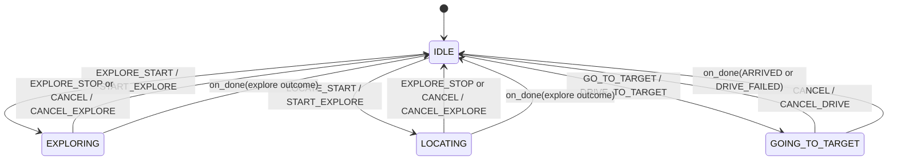

# mission_fsm — The Mission State Machine

## What this module is

`mission_fsm.py` is the **brain of dome_mission**, and it is deliberately tiny.
It decides *what the robot should be doing at the mission level* — exploring,
locating, driving to a target, or idle — and nothing else.

It has **no ROS imports**. It never sends an action goal, never reads a topic,
never resolves a label to a pose. It takes events in and hands *commands* back
out. The ROS node (`mission_node`, chapter 04) is what turns those commands into
real action calls.

That split is the *functional core / imperative shell* pattern:

- **Core** (this file): deterministic, synchronous, trivially unit-testable.
- **Shell** (`mission_node`): all the asynchrony, callbacks, and I/O.

## The vocabulary

The module defines four small enums plus one value object. Together they are the
entire language the core and the shell use to talk to each other.

```python
class State(Enum):
    IDLE = auto()
    EXPLORING = auto()
    LOCATING = auto()
    GOING_TO_TARGET = auto()
```

- **`State`** — where the mission is right now.
- **`Intent`** — what a human (or voice / UI layer) asked for: `EXPLORE_START`,
  `EXPLORE_STOP`, `LOCATE_START`, `GO_TO_TARGET`, `CANCEL`.
- **`Outcome`** — how a running behavior ended. Explore outcomes mirror the
  `ExploreArea` action result; drive outcomes summarize a Nav2 result.
- **`CommandType`** — the four primitives the shell knows how to execute.

The command itself is a frozen dataclass carrying just enough payload:

```python
@dataclass(frozen=True)
class Command:
    type: CommandType
    map_name: str = ""
    label: str = ""
```

Note that a `DRIVE_TO_TARGET` command carries a **label, not a pose**. The FSM
doesn't know where "chair" is — resolving that is the shell's job, using
`label_resolver` (chapter 03). This keeps the FSM free of any spatial data.

## The state diagram



Every behavior is a **round trip from IDLE and back**. There are no
behavior-to-behavior transitions: to go from exploring to driving, you stop
exploring first. That is the simplest policy that can't get confused, and the
code comments say preemption is intentionally deferred.

## Two kinds of input

The FSM has exactly two entry points, and the distinction matters.

### `on_intent` — someone asked for something

```python
def on_intent(self, intent, *, label="", map_name="") -> list[Command]:
    if intent in (Intent.EXPLORE_START, Intent.LOCATE_START):
        return self.begin_explore(intent, map_name)
    if intent is Intent.GO_TO_TARGET:
        return self.begin_drive(label)
    if intent in (Intent.EXPLORE_STOP, Intent.CANCEL):
        return self.abort(intent)
    return []
```

This is a **dispatcher**: intents fall into three families (start explore, start
drive, stop), each with its own helper. The keyword-only `label` / `map_name`
arguments mean a caller can't accidentally swap them positionally.

### `on_done` — a running behavior finished

```python
def on_done(self, outcome: Outcome) -> list[Command]:
    explore_done = self.state in EXPLORE_STATES and outcome in EXPLORE_OUTCOMES
    drive_done = self.state is State.GOING_TO_TARGET and outcome in DRIVE_OUTCOMES
    if explore_done or drive_done:
        self.state = State.IDLE
    return []
```

`on_done` always returns `[]`. A finished behavior never triggers a follow-up
command — the action already ended, so there is nothing to cancel or start.
It still returns a list so both entry points share one signature, which keeps
the door open for future sequencing (e.g. "explore, *then* go to the chair").

## The key invariant: inapplicable events are no-ops

The class docstring states the rule that makes this FSM robust:

> both ignore events that don't apply to the current state (return [], state
> unchanged) so a stray event never wedges the FSM.

Concretely:

- `EXPLORE_START` while already exploring → ignored (no second goal).
- `GO_TO_TARGET` while exploring → ignored (no preemption yet).
- A drive outcome arriving while exploring → ignored (wrong family).
- An explore outcome arriving after the user already cancelled → ignored
  (state is already IDLE).

That last case is the important one. When the user cancels, `abort` drops to
IDLE *immediately*, and the action's real `STOPPED` result arrives later. The
**family check** (`EXPLORE_STATES` × `EXPLORE_OUTCOMES`) is what makes that late
result harmless.

## Explore vs. locate: same primitive, different meaning

```python
def begin_explore(self, intent, map_name):
    if self.state is not State.IDLE:
        return []
    starting = intent is Intent.EXPLORE_START
    self.state = State.EXPLORING if starting else State.LOCATING
    return [Command(CommandType.START_EXPLORE, map_name=map_name)]
```

`EXPLORING` and `LOCATING` emit the **identical** `START_EXPLORE` command. The
difference is purely *mission intent*: semantic ingest (dome_semantic) runs
all the time, externally, so "locate targets" is just "explore, and we care about
what the camera sees." Keeping them as distinct states preserves that meaning
for telemetry (`/mission/state`) and for future behaviors that might diverge.

## Asymmetric cancel

```python
def abort(self, intent):
    if self.state in EXPLORE_STATES:
        self.state = State.IDLE
        return [Command(CommandType.CANCEL_EXPLORE)]
    if intent is Intent.CANCEL and self.state is State.GOING_TO_TARGET:
        self.state = State.IDLE
        return [Command(CommandType.CANCEL_DRIVE)]
    return []
```

- **`EXPLORE_STOP`** stops only exploration.
- **`CANCEL`** stops *anything*.

So "stop exploring" said during a drive does nothing — a sensible guard against
a misheard voice command aborting the wrong behavior.

## The boundary decision

The module docstring records a settled design boundary: **per-goal** failures
(a single frontier goal timing out, the robot getting stuck, blacklisting) are
handled *inside dome_nav's explorer* and never become FSM events. The FSM only
sees the *single terminal* `ExploreArea` outcome.

This is a classic layering choice: each layer owns the failures it can actually
fix. The explorer can pick another frontier; the mission layer can't, so it
shouldn't be told.

## Observations and possible improvements

1. **`LOCATING` is unreachable in practice.** No `/intent` name maps to
   `Intent.LOCATE_START` (see `intent_parser`, chapter 02), so the state exists
   and is tested but can't be entered from the live system.
2. **The `[]` return from `on_done` is speculative generality.** It's justified
   only if sequencing ("explore then go") is coming. If not, returning `None`
   would be more honest.
3. **Silent rejections lose information.** Ignored intents return `[]` with no
   reason. Returning a small result (e.g. `ignored: "busy exploring"`) would let
   the node log *why* "go to the chair" did nothing.
4. **The if-chain in `on_intent` could be a lookup table** mapping each `Intent`
   to its handler — the same pattern `mission_node.execute` already uses for
   commands.
