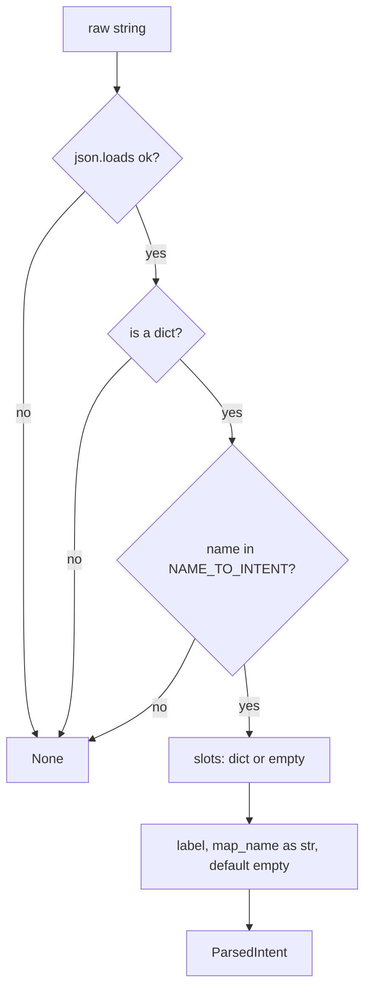

# intent_parser — From JSON on the Wire to a Typed Intent

## What this module does

Upstream producers (voice, the control CLI, diagnostics) talk to dome_mission by
publishing a **JSON object inside a `std_msgs/String`** on `/intent`.
`intent_parser.py` is the one function that turns that untyped string into a
typed `ParsedIntent` the FSM can consume.

Like the FSM, it is **pure**: no ROS. The node only pulls `msg.data` out of the
String and passes it here. That means the entire wire contract can be tested
with plain strings.

## The wire contract

A payload looks like this:

```json
{"name": "navigation_go", "source": "tool", "slots": {"label": "chair"}}
```

- **`name`** selects the intent.
- **`slots`** carries arguments; which slots matter depends on the name.
- Any other keys (`source` above) are ignored.

The supported names live in a single lookup table:

```python
NAME_TO_INTENT = {
    "exploration_start": Intent.EXPLORE_START,
    "exploration_stop": Intent.EXPLORE_STOP,
    "navigation_go": Intent.GO_TO_TARGET,
    "navigation_cancel": Intent.CANCEL,
}
```

A table instead of an if-chain means adding an intent is a one-line change, and
the contract is readable at a glance. Two names are notably *absent*:

- **`stop`** — deliberately excluded. `dome_control` owns a pure motor-halt
  `stop`; mission cancel is the explicit `navigation_cancel` /
  `exploration_stop`. Keeping them apart avoids one word doing two jobs.
- **anything for `LOCATE_START`** — the FSM supports it, but there's no wire
  name yet.

## The output type

```python
@dataclass(frozen=True)
class ParsedIntent:
    intent: Intent
    label: str = ""
    map_name: str = ""
```

The parser **flattens** the nested `slots` dict into two named fields. That's the
boundary doing its job: past this point, nobody touches a raw dict again.

## The parsing pipeline



There are **three rejection gates**, each catching a distinct, real failure:

1. Not JSON at all (a typo, or a non-string from a buggy publisher).
2. Valid JSON but not an object (`"hello"`, `[1, 2]`).
3. An object with an unknown or missing `name`.

```python
try:
    payload = json.loads(json_str)
except (json.JSONDecodeError, TypeError):
    return None
if not isinstance(payload, dict):
    return None
```

Every rejection returns `None`. The caller (`mission_node.on_intent`) logs a
warning with the raw payload and drops it — a malformed message is reported,
never guessed at.

## Slot handling — the soft part

```python
slots = payload.get("slots") or {}
if not isinstance(slots, dict):
    slots = {}
label = slots.get("label", "") or ""
map_name = slots.get("map_name", "") or ""
return ParsedIntent(intent=intent, label=str(label), map_name=str(map_name))
```

Unlike the three gates above, slot problems are **absorbed** rather than
rejected:

- missing `slots`, `null` slots, or non-dict slots → treated as empty;
- missing or `null` `label` / `map_name` → `""`;
- a non-string value (say `"label": 7`) → coerced with `str()`.

Some of this is legitimate: `map_name=""` really does mean "use the session's
map." But a `navigation_go` with no label sails through as `label=""` and only
fails later, in the resolver, with a less specific message.

## Observations and possible improvements

1. **Slot coercion is a guess-and-repair.** Coercing `7` → `"7"` and
   non-dict slots → `{}` hides producer bugs; the style guide prefers rejecting
   them at the boundary. This is the subject of open issue **I03**.
2. **Required slots aren't enforced.** `navigation_go` without a `label` should
   be rejected here, where the error is clearest, rather than surfacing as "no
   confirmed target for label ''".
3. **`None` loses the reason.** A small result type (or raising a
   `ValueError` with the cause) would let the node log *which* gate failed.
4. **The JSON-in-String transport itself is the root issue.** Feature F08
   (deferred) proposes typed `Intent` messages, which would make most of this
   module unnecessary.
