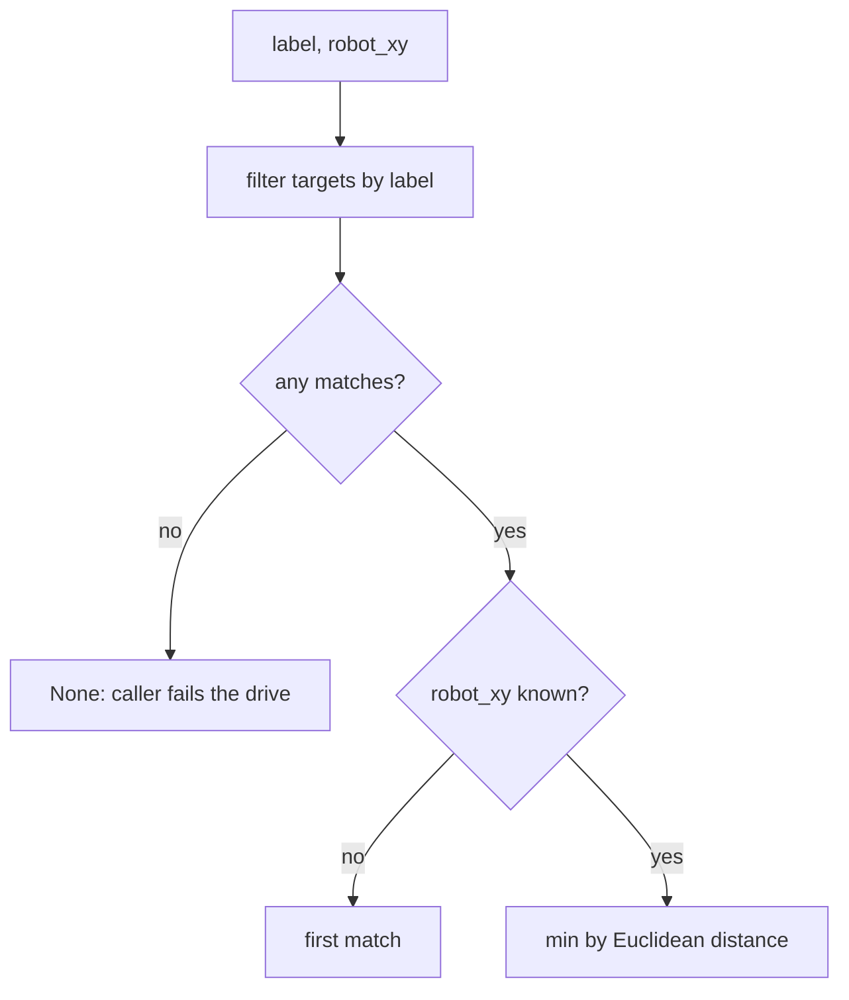

# label_resolver — Turning "chair" Into a Pose

## What this module does

When someone says "go to the chair," the FSM emits `DRIVE_TO_TARGET(label="chair")`.
Somebody has to answer *which* chair, and *where*. That's `label_resolver.py`.

It holds the **latest snapshot of confirmed semantic targets** (published by
`dome_semantic`) and, given a label and the robot's position, picks a single
goal pose. It is pure Python — the ROS-message conversion happens in the node.

## The data: `TargetPose`

```python
@dataclass(frozen=True)
class TargetPose:
    label: str
    target_id: str
    x_m: float
    y_m: float
    yaw_rad: float
```

This is a deliberate **projection** of the richer `SemanticTarget` message down
to exactly what navigation needs:

- **2-D position** in the `map` frame (`x_m`, `y_m`) — the robot drives on a
  plane, so `z` is dropped.
- **A single yaw angle** instead of a quaternion — easier to reason about and to
  test.
- **Units in the names**, so nobody wonders whether `x` is meters or cells.

Being `frozen` makes each target an immutable value: the store can hand them out
without worrying about callers mutating them.

## Quaternions in one dimension

```python
def yaw_from_quaternion(z: float, w: float) -> float:
    return 2.0 * math.atan2(z, w)
```

A rotation by angle θ about the z-axis has the quaternion
`(x, y, z, w) = (0, 0, sin(θ/2), cos(θ/2))`. So the angle is recoverable as
`θ = 2·atan2(z, w)`.

- This is **only valid for pure-yaw rotations** (`x = y = 0`) — true for a
  ground robot's targets.
- It's the exact inverse of what `mission_node.goal_pose` does when building
  the Nav2 goal, so a target round-trips cleanly.
- `atan2` (not `atan`) keeps the correct quadrant and handles `w = 0`.

The general formula (used in `tools/nav_intent_check.py`) includes `x` and `y`
terms; with `x = y = 0` it reduces to this one.

## The store

```python
@dataclass
class SemanticTargetStore:
    targets: list[TargetPose] = field(default_factory=list)

    def update(self, targets: list[TargetPose]):
        self.targets = list(targets)
```

`update` **replaces** the whole list rather than merging. That matches the
upstream contract: each `SemanticTargetArray` is a *complete snapshot* of the
semantic map, not a delta. The `list(...)` copy decouples the store from the
caller's list.

`field(default_factory=list)` is the standard dataclass idiom for a mutable
default — a bare `= []` would be shared between instances.

## Resolution: nearest match

```python
def resolve(self, label, robot_xy):
    matches = [target for target in self.targets if target.label == label]
    if not matches:
        return None
    if robot_xy is None:
        return matches[0]
    robot_x, robot_y = robot_xy

    def distance(target):
        return math.hypot(target.x_m - robot_x, target.y_m - robot_y)

    return min(matches, key=distance)
```



A few things worth noticing:

- **Linear scan, O(n).** The semantic map holds tens of targets, not millions,
  so a spatial index (k-d tree) would be pure overhead.
- **`math.hypot`** is the numerically careful way to compute √(dx² + dy²).
- **Straight-line distance, not path distance.** The "nearest" chair may be
  behind a wall. Nav2 will still get there, just maybe not to the closest one
  by travel.
- **No pose → first match.** Navigation proceeds rather than blocking. Today
  that path is the *common* one in sim, because the explore stack has no AMCL
  (issue **I02**).

## Observations and possible improvements

1. **The no-pose fallback is a silent default.** Picking `matches[0]` when the
   robot's position is unknown is arbitrary and unlogged; the caller can't tell
   it happened. At minimum the node should log it.
2. **Exact, case-sensitive label match.** `"Chair"` won't find `"chair"`.
   Normalizing at the ingest boundary would be cheap.
3. **Path cost would beat Euclidean distance** if there are many candidates —
   Nav2's `ComputePathToPose` could rank them, at the price of a service call
   per candidate.
4. **`target_id` is carried but unused** here. It would be useful in the
   "Driving to …" log line, to say *which* chair was chosen.
