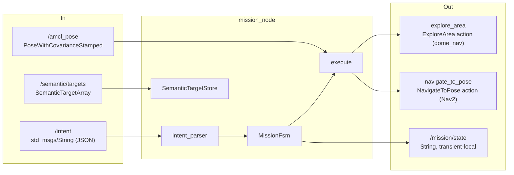
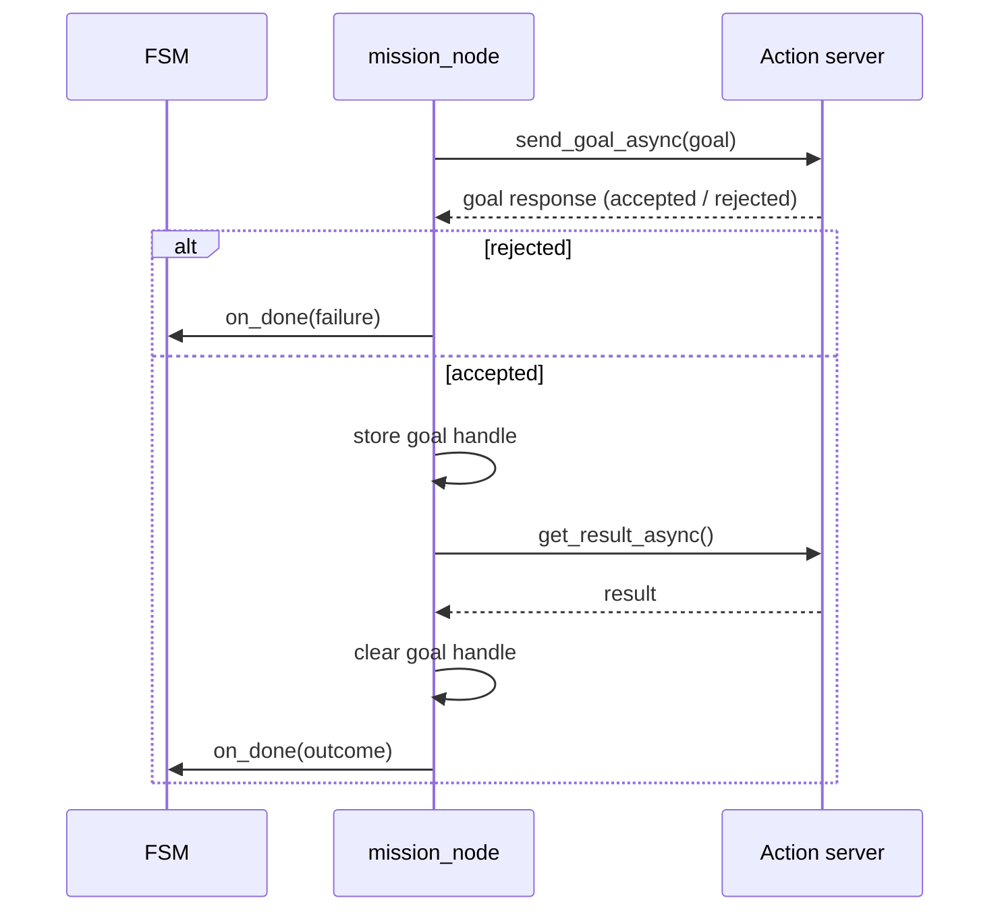

# mission_node — The ROS Seam

## What this module does

`mission_node.py` is the **imperative shell** around the three pure modules.
It is the only file in the package's runtime path that imports `rclpy`.

Its job, in one sentence: **translate ROS traffic into FSM events, and FSM
commands into ROS action calls.** Everything that requires judgment — which
state to be in, which chair to pick — is delegated.

## The node's interfaces



- **Three subscriptions:** intents, the semantic map, the robot's pose.
- **Two action clients:** dome_nav's explorer, Nav2's navigator.
- **One publisher:** the FSM's current state, for `dome_control`.

## Construction

```python
self.fsm = MissionFsm()
self.store = SemanticTargetStore()
self.robot_xy = None
self.drive_goal_handle = None
self.explore_goal_handle = None
```

The node's *mutable state* is just these five fields. Two of them are the pure
objects; `robot_xy` is the last known pose; the two goal handles track which
action goal (if any) is in flight, so it can be cancelled.

### Transient-local state publishing

```python
state_qos = QoSProfile(depth=1, durability=QoSDurabilityPolicy.TRANSIENT_LOCAL)
self.state_pub = self.create_publisher(String, "/mission/state", state_qos)
self.publish_mission_state()
```

**`TRANSIENT_LOCAL` durability** is ROS 2's "latched topic": the publisher keeps
the last `depth` messages and replays them to any subscriber that joins later.
With `depth=1`, a `dome_control` CLI started an hour after boot still
immediately learns the current mission state, without waiting for a
transition. The subscriber must also request transient-local for this to work.

## Intent handling

```python
def on_intent(self, msg: String):
    parsed = parse_intent(msg.data)
    if parsed is None:
        self.get_logger().warning(f"Malformed or unknown intent: {msg.data!r}")
        return
    commands = self.fsm.on_intent(
        parsed.intent, label=parsed.label, map_name=parsed.map_name
    )
    ...
    self.publish_mission_state()
    for command in commands:
        self.execute(command)
```

The flow is **parse → step the FSM → publish state → execute commands**. The
`!r` in the warning prints the payload with quotes and escapes, so an empty or
whitespace-only message is visible in the log.

### Dispatching commands

```python
def execute(self, command: Command):
    handlers = {
        CommandType.DRIVE_TO_TARGET: lambda: self.drive_to_label(command.label),
        CommandType.CANCEL_DRIVE: self.cancel_drive,
        CommandType.START_EXPLORE: lambda: self.start_explore(command.map_name),
        CommandType.CANCEL_EXPLORE: self.cancel_explore,
    }
    handlers[command.type]()
```

A **dispatch table** keyed by `CommandType`. The lambdas adapt handlers that need
a payload field to the uniform zero-argument call. Because the table is
exhaustive over `CommandType`, an unknown type is a `KeyError` — a loud failure,
which is the right outcome for a programming error.

## Ingesting the semantic map

```python
for target in msg.targets:
    if target.schema_version != EXPECTED_SCHEMA_VERSION:
        dropped += 1
        continue
    yaw_rad = yaw_from_quaternion(
        target.pose.orientation.z, target.pose.orientation.w
    )
    kept.append(TargetPose(...))
```

This is the **validation boundary** for semantic data:

- **Schema gating.** Each target carries a `schema_version`. Targets from a
  newer or older producer are dropped *and counted*, and one warning summarizes
  the count — reported, not silently ignored.
- **Conversion.** ROS `Pose` → pure `TargetPose`, quaternion → yaw. Past here,
  the resolver never sees a ROS type.

The store is then replaced wholesale with the kept list.

## Actions: the asynchronous part

Both behaviors use the same **three-stage action client pattern**:



No stage blocks the executor: each one registers a **done-callback** on a future
and returns. That's essential in a single-threaded `rclpy.spin` — a blocking
wait inside a callback would stall every other subscription.

### Explore

```python
def start_explore(self, map_name: str):
    if not self.explore_client.server_is_ready():
        self.get_logger().error("ExploreArea server unavailable")
        self.fsm.on_done(Outcome.STOPPED)
        return
    goal = ExploreArea.Goal()
    goal.map_name = map_name
    send_future = self.explore_client.send_goal_async(goal)
    send_future.add_done_callback(self.on_explore_response)
```

`server_is_ready()` is a **non-blocking** check. If dome_nav isn't up, the
behavior fails immediately and the FSM returns to IDLE.

The result is mapped back into the FSM's vocabulary with a table:

```python
EXPLORE_OUTCOMES = {
    ExploreArea.Result.EXPLORED_DONE: Outcome.EXPLORED_DONE,
    ExploreArea.Result.STOPPED: Outcome.STOPPED,
    ExploreArea.Result.NO_TARGETS_BLOCKED: Outcome.NO_TARGETS_BLOCKED,
}
...
outcome = EXPLORE_OUTCOMES.get(future.result().result.outcome, Outcome.STOPPED)
```

### Drive to a label

```python
def drive_to_label(self, label: str):
    target = self.store.resolve(label, self.robot_xy)
    if target is None:
        self.get_logger().warning(f"No confirmed target for label {label!r}")
        self.fsm.on_done(Outcome.DRIVE_FAILED)
        return
    if not self.nav_client.wait_for_server(timeout_sec=1.0):
        ...
```

Resolution happens **at execution time**, using whatever targets and pose the
node has right now. An unknown label fails the behavior cleanly, so the FSM
doesn't sit in `GOING_TO_TARGET` forever.

Drive success is judged on the action's **goal status**, not a result field:
`STATUS_SUCCEEDED` → `ARRIVED`, anything else (aborted, canceled) →
`DRIVE_FAILED`.

### Building the Nav2 goal

```python
pose.header.frame_id = "map"
pose.header.stamp = self.get_clock().now().to_msg()
pose.pose.orientation.z = math.sin(target.yaw_rad / 2.0)
pose.pose.orientation.w = math.cos(target.yaw_rad / 2.0)
```

This is the inverse of `yaw_from_quaternion`: yaw θ → `(0, 0, sin θ/2, cos θ/2)`.
The goal is stamped "now" in the `map` frame, the same frame the targets and
`/amcl_pose` are in.

### Cancelling

```python
def cancel_explore(self):
    if self.explore_goal_handle is not None:
        self.explore_goal_handle.cancel_goal_async()
        self.explore_goal_handle = None
```

The FSM has *already* moved to IDLE when this runs. The server's eventual
`STOPPED` / canceled result still arrives, still calls `on_done`, and the FSM
ignores it because the state no longer matches (chapter 01's family check).

## Clean shutdown

```python
try:
    rclpy.spin(node)
except (KeyboardInterrupt, ExternalShutdownException):
    pass  # Ctrl-C or the launcher's SIGTERM: a normal stop
finally:
    node.destroy_node()
    rclpy.try_shutdown()
```

- **`ExternalShutdownException`** is what `rclpy.spin` raises when the context is
  shut down by a signal — the path a launcher's SIGTERM takes. Treating it like
  Ctrl-C stops a traceback from appearing on every normal launch teardown.
- **`try_shutdown`** (not `shutdown`) is idempotent: the signal handler may have
  already shut the context down.

## Observations and possible improvements

1. **`/mission/state` goes stale after a behavior ends.** State is published only
   at startup and in `on_intent`. Every `fsm.on_done(...)` — explore finished,
   drive arrived, goal rejected, unknown label — moves the FSM to IDLE without
   republishing. Even within `on_intent`, the state is published *before*
   `execute`, so a synchronous failure (no server, unknown label) leaves
   subscribers seeing `GOING_TO_TARGET` / `EXPLORING`. A single wrapper that
   calls `fsm.on_done` and then publishes would fix all of them.
2. **A late result can clobber a newer goal.** Cancel an explore and immediately
   start another: if the *old* goal's result arrives after the new goal is
   accepted, `on_explore_result` clears `explore_goal_handle` (now the new
   one's) and calls `on_done(STOPPED)` while the state is `EXPLORING` again —
   dropping the FSM to IDLE while the new explore keeps running. The same
   applies to drives. Binding each result callback to its own handle (and
   ignoring results for handles that aren't current) closes this.
3. **Unknown explore outcome → silent `STOPPED`.** The `.get(..., Outcome.STOPPED)`
   default hides a contract mismatch with dome_nav; it should warn, or fail.
4. **Inconsistent server checks.** Explore uses non-blocking `server_is_ready()`;
   drive uses `wait_for_server(timeout_sec=1.0)`, which blocks the
   single-threaded executor for up to a second inside a subscription callback.
5. **`robot_xy` never expires.** A pose from minutes ago is used as if current;
   storing the stamp would allow a staleness check.
