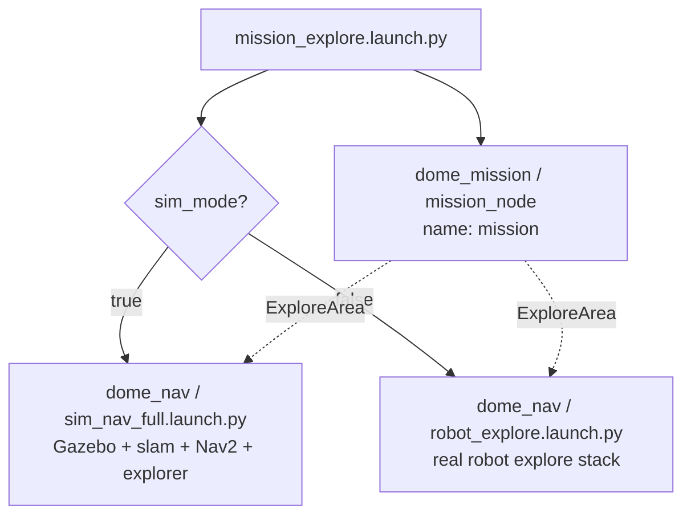

# mission_explore.launch.py — Bringing Up the Whole Stack

## What this file does

This is the **top-level launch file** for the mission layer. One command brings
up either the real robot's or the simulator's navigation stack (from dome_nav)
*plus* dome_mission's `mission_node` on top of it.

It uses **better_launch** rather than stock ROS 2 launch. better_launch turns a
plain decorated Python function into a launch file: function parameters become
command-line arguments, and the body runs imperatively.

```bash
bl dome_mission mission_explore.launch.py --map_name <name> [--sim_mode true]
```

## The composition



Only two things get launched: **one dome_nav sub-stack** and **one
mission_node**. dome_semantic (and the OAK-D camera) is not composed here yet,
so `/semantic/targets` has no publisher in this launch.

## Arguments

```python
@launch_this(ui=True)
def mission_explore_launch(
    sim_mode: str = "false",
    map_name: str = "",
    world_name: str = "",
    urdf_name: str = "minimal_sim.urdf",
):
```

- **`map_name`** — required in practice; validated immediately.
- **`world_name` / `urdf_name`** — sim only; passed to the Gazebo stack.
- **`sim_mode`** — chooses the sub-stack. `ui=True` enables better_launch's
  terminal UI.

### Why `sim_mode` and not `use_sim_time`

This is the most non-obvious decision in the file. better_launch reserves a
global `--use-sim-time` flag. Because click normalizes `--use-sim-time` and
`use_sim_time` to the *same destination*, a parameter with that name would be
**silently overridden** by the global. Naming it `sim_mode` sidesteps the
collision; the included launch files set the real ROS `use_sim_time` themselves.

### Why a string, parsed by hand

```python
sim_mode = {
    "true": True, "t": True, "1": True, "yes": True,
    "false": False, "f": False, "0": False, "no": False,
}[sim_mode.strip().lower()]
```

Launch arguments arrive as strings. Rather than trusting `bool("false")` (which
is `True`), the file uses an **explicit lookup table**. Anything outside the
table raises `KeyError` — an unrecognized value fails the launch instead of
being guessed at.

### Validating `map_name`

```python
if not map_name:
    raise ValueError(
        "map_name is required: "
        "bl dome_mission mission_explore.launch.py --map_name <name>"
    )
```

Failing at launch time, with the corrected command in the message, beats a
SLAM stack that starts with no map and fails obscurely later.

## The mission node

```python
bl.node(
    "dome_mission",
    "mission_node",
    name="mission",
    ros_waittime=30.0,
)
```

The node is renamed to **`mission`** — which is why `ros2 action info
/explore_area` lists the client as `/mission`. `ros_waittime=30.0` is how long better_launch waits for *this
node's process* to register with ROS (the default is 3 s). That check only
gates better_launch's lifecycle handling, and `mission_node` isn't a lifecycle
node, so the long timeout is headroom for a slow start on the Pi rather than
something the node depends on.

## A known layering exception

DOME's launch convention is two-level, and **packages may not include each
other's launch files** — composition belongs in the `dome2` top-level package.
This file breaks that rule by including dome_nav. It's recorded as a known
exception (dome2 F05), to be split or moved once dome_nav's Nav2 params are
migrated (dome_nav I13).

## Observations and possible improvements

1. **Leftover `print`.** The banner line that echoes all arguments is a debug
   print, and it runs well past 88 characters. better_launch's logger (or
   removing it) would be cleaner.
2. **`use_sim_time=str(sim_mode).lower()` in the robot branch is always
   `"false"`.** That branch only runs when `sim_mode` is false, so the
   expression is a roundabout constant.
3. **`map_name` has a default only to be rejected.** Making it a required
   parameter (no default) would let better_launch report the error itself.
4. **No go-to-label support.** There's no `amcl` in this stack (issue I02) and
   no semantic producer, so only the explore leg works end-to-end from this
   launch.
