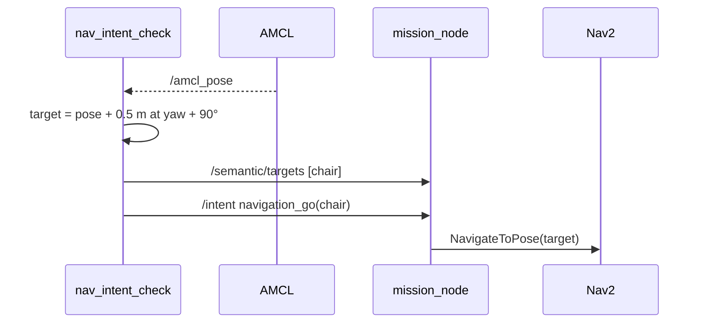

# Appendix X01 — nav_intent_check: A Live Go-to-Label Smoke Test

## What this tool does

`tools/nav_intent_check.py` exercises the **whole go-to-label path on a live
robot**, with no camera and no semantic pipeline. It fakes the one missing
input — a semantic target — and then asks dome_mission to drive there.

1. Read the robot's pose from `/amcl_pose`.
2. Invent a `chair` target **50 cm to the robot's left**.
3. Publish it as a typed `SemanticTargetArray` on `/semantic/targets`.
4. Publish a `navigation_go` intent for `chair` on `/intent`.

If the robot turns and drives half a meter left, the parser, FSM, resolver,
goal building and Nav2 hand-off all work.



## Safety first

The script starts with a human confirmation, because it moves a real robot:

```python
print("\nWARNING: Ensure at least 1m clear space in ALL directions.")
...
return input("Proceed? [y/n]: ").strip().lower() == "y"
```

Anything but `y` aborts before ROS is even initialized.

## Waiting on QoS-matched topics

```python
amcl_qos = QoSProfile(
    depth=1,
    reliability=ReliabilityPolicy.RELIABLE,
    durability=DurabilityPolicy.TRANSIENT_LOCAL,
)
```

AMCL publishes its pose **transient-local**, so subscribing the same way gets
the last pose immediately rather than waiting for the robot to move. Nav2's AMCL
only republishes on motion or periodic updates, so a volatile subscriber on a
stationary robot might never receive anything.

## Placing the target

```python
def compute_target(self):
    pose = self.current_pose
    left_yaw = self.current_yaw() + math.pi / 2.0
    target_x = pose.position.x + GOAL_DIST_M * math.cos(left_yaw)
    target_y = pose.position.y + GOAL_DIST_M * math.sin(left_yaw)
    return (round(target_x, 3), round(target_y, 3), left_yaw)
```

This is **polar → Cartesian**: rotate the heading by +90° (counter-clockwise =
left, in ROS's right-handed z-up convention) and step `GOAL_DIST_M` along it.
The target's yaw is that same direction, so the robot ends up facing along the
offset.

`current_yaw` uses the **full quaternion-to-yaw formula**
`atan2(2(wz + xy), 1 − 2(y² + z²))`, which is correct for any orientation; for a
planar pose it agrees with the simpler `2·atan2(z, w)` in `label_resolver`.

## Publishing reliably to a fresh subscriber

```python
self.wait_for_subscriber(self.targets_pub)
for _ in range(3):
    self.targets_pub.publish(array)
    self.spin_for(0.1)
```

Two small techniques handle ROS 2 discovery latency:

- **Wait for a subscriber** before publishing — a message published before
  discovery completes is simply lost.
- **Publish the snapshot three times**, spinning in between. Because each array
  *replaces* the store (chapter 03), repeats are harmless.

The intent is published once, after the targets, so the resolver already has
the chair when the drive command arrives.

## What it doesn't check

The tool stops at "intent sent." It doesn't confirm arrival, because when it was
written dome_mission had no status output. You watch the robot, RViz, or the
`mission_node` log.

## Observations and possible improvements

1. **`/mission/state` now exists** and could be used to assert the outcome:
   wait for `GOING_TO_TARGET`, then `IDLE`. But see chapter 04: today that topic
   doesn't republish when a drive finishes, so it would need that fix first.
2. **`wait_for_subscriber` gives up silently.** After 5 s with no subscriber it
   returns and publishes anyway; it should report failure, as `wait_for_pose`
   does.
3. **Two yaw implementations.** The tool's general formula and the resolver's
   planar one compute the same thing here; importing one shared helper would
   remove the duplication.
4. **Blocked in sim today** — the explore stack has no AMCL (I02), so step 1
   times out there; this is a real-robot tool for now.
